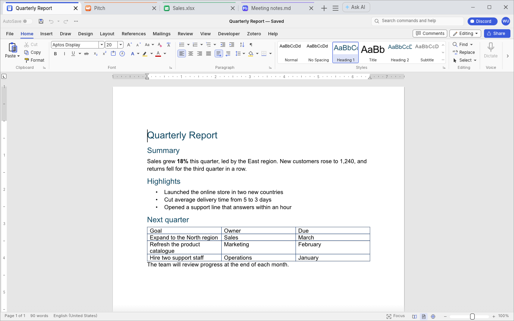
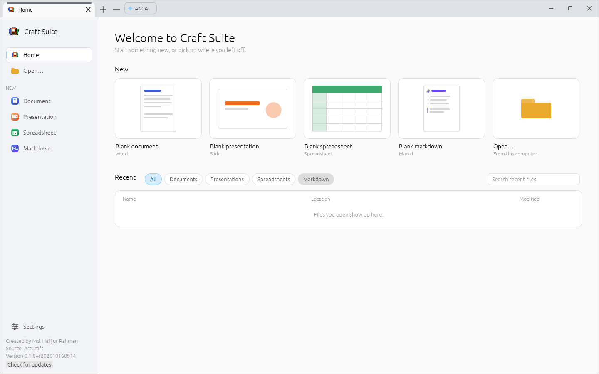
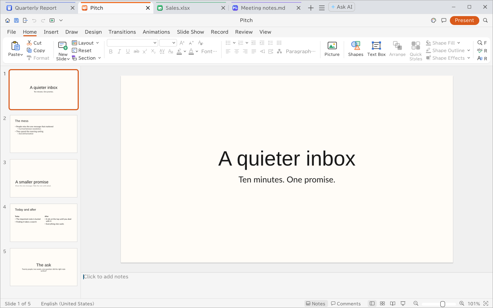
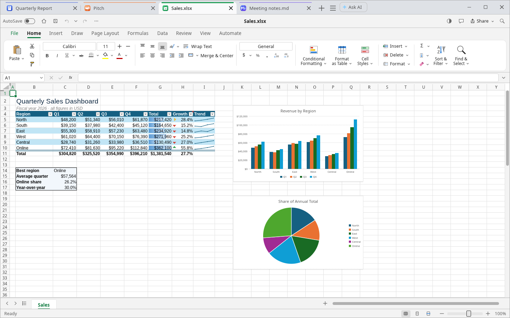
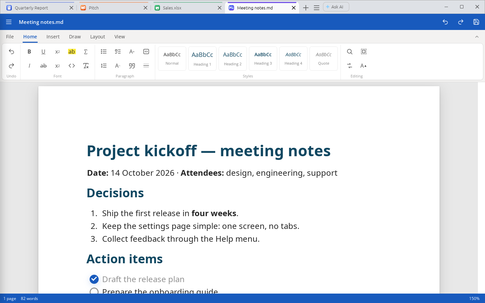
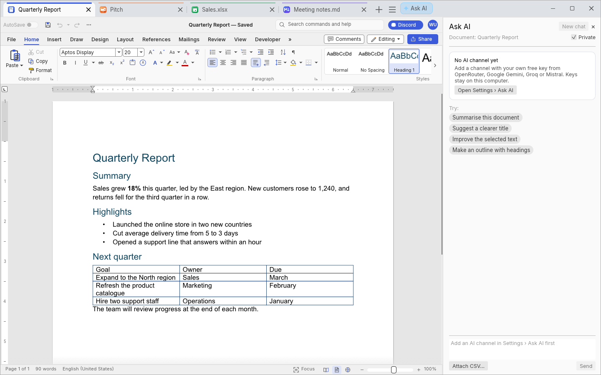

<div align="center">


# Craft Suite

**An open-source office suite in one tabbed window: Word, Slide, Spreadsheet and Markd.**

[](https://github.com/Hafij-BGE/software/releases/latest)
[](https://github.com/Hafij-BGE/software/actions/workflows/build-deb.yml)
[](#install)
[](#licences)
[](suite/)

[**Download**](https://github.com/Hafij-BGE/software/releases/latest) ·
[Install](#install) ·
[Features](#features) ·
[Ask AI](#ask-ai) ·
[Build](#build-it-yourself) ·
[Upstream updates](#updates-from-upstream)



</div>

Craft Suite puts four apps in one window, each document in its own tab:

<table>
<tr>
<td align="center" width="25%"><br><b>Word</b><br><sub><code>.docx</code> <code>.odt</code> <code>.rtf</code> <code>.doc</code></sub></td>
<td align="center" width="25%"><br><b>Slide</b><br><sub><code>.pptx</code>, slide shows, animations</sub></td>
<td align="center" width="25%"><br><b>Spreadsheet</b><br><sub><code>.xlsx</code> <code>.csv</code>, formulas, charts</sub></td>
<td align="center" width="25%"><br><b>Markd</b><br><sub><code>.md</code>, WYSIWYG Markdown</sub></td>
</tr>
</table>

Word, Slide and Spreadsheet are ArtCraft's [WordCraft](https://github.com/storytold/wordcraft),
[DeckCraft](https://github.com/storytold/deckcraft) and [GridCraft](https://github.com/storytold/gridcraft):
open-source Rust apps for word processing, presentations and spreadsheets (.docx, .pptx, .xlsx). Markd is
[Markd](https://github.com/Hafij-BGE/markd), a Markdown editor based on MarkText. Created by
**Md. Hafijur Rahman**.

## Quick start

**Linux** (Ubuntu 22.04+, Debian 12+, Mint 21+, amd64):

```sh
cd ~/Downloads
f="$(curl -fsSL https://github.com/Hafij-BGE/software/releases/latest/download/latest.txt | awk '$1 == "amd64" { print $3 }')"
curl -fLO "https://github.com/Hafij-BGE/software/releases/latest/download/$f"
sudo apt install "./$f"
```

**Windows** (10 or 11, 64-bit): run `craft-suite_<version>_windows-x64-setup.exe` from the
[latest release](https://github.com/Hafij-BGE/software/releases/latest).

## Screenshots

<table>
<tr>
<td width="50%"><br><sub><b>Home</b>: new documents, Open, recent files</sub></td>
<td width="50%"><br><sub><b>Slide</b>: presentations (<code>.pptx</code>)</sub></td>
</tr>
<tr>
<td><br><sub><b>Spreadsheet</b>: workbooks, formulas, charts</sub></td>
<td><br><sub><b>Markd</b>: Markdown with a Word-style ribbon</sub></td>
</tr>
<tr>
<td colspan="2"><br><sub><b>Ask AI</b> beside every tab: answers from the document you're on, with your own free keys</sub></td>
</tr>
</table>

## Features

| | |
|---|---|
| 🗂️ **Tabs that mix apps** | A document, a deck, a spreadsheet and a Markdown file side by side, each tab with its app's icon and colour. Drag to reorder; right-click to pin, colour, move or close others. |
| 🪟 **Tabs in the title bar** | Minimize, maximize and close sit beside the tabs. Settings › Window › Title bar switches back to the desktop's own. |
| 🎛️ **Your layout** | Tab bar at the top, bottom, left or right; tabs mixed, grouped by app or one row per app; colour per app (stripe, tint, solid); light, dark or system theme. |
| 🏠 **Home page** | Blank document, presentation, spreadsheet and Markdown tiles, Open, and recent files with search and a filter by app. |
| 🔤 **Missing fonts** | A document in a font that isn't installed says so in a bar over it, and installs it: from Google Fonts, from Windows on the same PC, or from font files. Or *Choose font* uses a similar installed font throughout (Undo takes it back). |
| 🧩 **Templates** | Letters, reports, a résumé, budgets, invoices, trackers and slide decks to start from, plus your own ([more](#templates)). |
| 📝 **Markd** | WYSIWYG Markdown with a ribbon, page layout, Mermaid diagrams, and HTML, PDF and Word export ([more](#markd)). |
| ✨ **Ask AI** | An assistant beside every tab that answers from the document and makes changes you accept, with your own free keys ([more](#ask-ai)). |
| 🔄 **Always current** | A weekly workflow merges upstream changes and publishes a release; installed copies update from the Home page ([more](#update)). |

**Keys:** **Ctrl+N** opens a new tab of the app you're in (Settings › Behaviour › Keyboard gives it
back to the app); **Ctrl+Alt+PageUp/PageDown** switches tabs; **Ctrl+Alt+Home** goes Home.

## Install

<details open>
<summary><b>Linux</b> (<code>.deb</code>)</summary>

<br>

Run the [quick start](#quick-start) lines, or download `craft-suite_<version>_amd64.deb` from the
[latest release](https://github.com/Hafij-BGE/software/releases/latest) and, in its folder, run
`sudo apt install ./craft-suite_*_amd64.deb`. Keep the `./`: it tells apt to install that file, and
apt also installs the system libraries the suite needs.

Start **Craft Suite** from the applications menu (Word, Slide, Spreadsheet and Markd entries open a
new tab of that app), or from a terminal:

```sh
craft-suite                       # the Home page (or last session's files)
craft-suite report.docx data.xlsx # each file in a tab of its app
craft-suite notes.md              # a Markd tab
craft-suite --new slide           # a blank presentation (word, slide, sheet, mark or home)
wordcraft-cli --help              # the headless converters/command runners are included
```

The package replaces the upstream `wordcraft`, `deckcraft` and `gridcraft` packages if they're
installed (it ships the same CLI tools, file types and icons).

</details>

<details>
<summary><b>Windows</b> (installer or zip)</summary>

<br>

From the [latest release](https://github.com/Hafij-BGE/software/releases/latest):

- `craft-suite_<version>_windows-x64-setup.exe`: installs to Program Files (or just for you), adds
  Craft Suite, Word, Slide, Spreadsheet and Markd to the Start menu, offers a desktop shortcut, and
  lists Craft Suite under **Open with** for documents, presentations, spreadsheets and Markdown
  (without taking over your defaults). Uninstall it in Settings › Apps.
- `craft-suite_<version>_windows-x64.zip`: no installer; unzip it anywhere and run
  `craft-suite.exe`.

The files aren't code-signed, so SmartScreen warns about an unknown publisher the first time:
**More info › Run anyway**. Settings are kept in `%APPDATA%\craft-suite`. On Windows each start
opens its own window for now, and **Get updates** on the Home page opens the Releases page, where
you download the newer installer and run it over the old one.

</details>

<details>
<summary><b>Uninstall</b></summary>

<br>

```sh
sudo apt remove craft-suite     # the program, menu entries, file types and icons
sudo apt purge craft-suite      # the same, and /etc/craft-suite/update.conf
```

Your settings stay in `~/.config/craft-suite` in case you reinstall; delete that folder to remove
them. Your documents are never touched.

</details>

## Update

- **From the app:** **Check for updates** on the Home page (or Settings › Updates) shows "Update
  available" when there's a newer release; **Install update** installs it after asking for your
  password. Settings › Starting › **Check for updates** checks each time the suite opens.
- **From a terminal:** `craft-suite-update` (asks before installing), or
  `craft-suite-update --check` to only look.
- **By hand:** run the [quick start](#quick-start) lines again; settings and open files are kept.

Restart Craft Suite after an update. Nothing is installed without your password.

## Templates

The Home page's **Templates** start a new document, presentation or spreadsheet from a ready-made
one: letters, a report, a résumé and cover letter, meeting minutes, a proposal, a research paper and
a flyer; a budget, an invoice, a timesheet, a project tracker, a grade book, an expense report and an
experiment log; and six slide designs. Filter them by app or search; picking one opens an untitled
copy, so the template itself never changes.

- **Your own:** *My templates folder* opens `~/.local/share/craft-suite/templates` (Windows:
  `%APPDATA%\craft-suite\templates`). Every document, presentation or spreadsheet you put there is
  listed under *My templates*, with a `<name>.png` beside it as its picture.
- **Licences:** Craft Suite's own templates are CC0 (use them for anything). Open-licence ones
  collected from the LibreOffice community (CC0, CC-BY or public domain only) are credited in
  [`templates/ATTRIBUTION.md`](templates/ATTRIBUTION.md).
- **Making them:** `scripts/templates/make_own.py` writes the suite's own;
  `.github/workflows/templates.yml` collects and converts the open-licence ones; `build_index.py`
  draws the thumbnails with the apps themselves and writes `templates/index.json`.

## Markd

Markdown files (`.md`, `.markdown`) open in **Markd** tabs. **Blank markdown** on the Home page,
`craft-suite --new mark`, or **Ctrl+N** in a Markd tab starts one.

- WYSIWYG Markdown (MarkText's muya editor) with a Word-style ribbon (**File, Home, Insert, Draw,
  Layout, View**), Source view, find and replace, word and page counts.
- **Diagrams and code:** ```` ```mermaid ```` blocks render as diagrams at their own size (a wide
  one scrolls sideways); code blocks keep ASCII art aligned; a fence without a language is plain
  text.
- **Page layout** on A4, US Letter or Legal; Word Light/Dark themes that follow the system.
  **Ctrl+wheel** or a touchpad pinch zooms the page; **Ctrl+=**, **Ctrl+-**, **Ctrl+0** step it.
- **Export:** HTML, **PDF** and **Word (.docx)**.
- Pasted and inserted pictures, and sketches (Draw), are saved in an `assets` folder next to the
  `.md` file. The ☰ menu has New, Open, **Open folder** and recent files.

| Key | Action | Key | Action |
|---|---|---|---|
| Ctrl+S | Save | Ctrl+Shift+S | Save as |
| Ctrl+O | Open | Ctrl+P | Export PDF |
| Ctrl+F | Find | Ctrl+H | Replace |
| Ctrl+Z | Undo | Ctrl+Y | Redo |

Closing a tab with unsaved changes asks first. **AutoSave** (on by default, File tab) saves a named
file as you type.

<details>
<summary>Good to know</summary>

<br>

- Markd tabs use the system web view: **WebKitGTK 4.1** on Linux (`libwebkit2gtk-4.1-0`, a
  dependency of the package) and **WebView2** on Windows (built in). On a Wayland desktop the suite
  runs through XWayland; with `CRAFT_SUITE_WAYLAND=1` Markd tabs don't open.
- The page is a native window over the tab: while a menu or prompt of the suite is open over it,
  the page steps aside.
- Markd's settings and recent files are kept in `~/.local/share/craft-suite/markd` (Windows:
  `%LOCALAPPDATA%\craft-suite\markd`).
- On Windows, **Export PDF** opens the page in your browser, to print it to PDF from there.

</details>

## Ask AI

Click **Ask AI** in the tab bar: a panel opens beside the tab. Each tab has its own conversation,
and the AI sees only that tab.

- **Answers from your document:** summarise, explain, improve the selected text, suggest a chart.
  Suggested questions show for each kind of tab.
- **Changes you can see:** the answer lists the steps (insert text, apply a style, add slides, fill
  cells, make a chart). **Apply** makes them; **Ctrl+Z** undoes them. The AI can only use a short
  list of editing commands: nothing that opens, saves, prints or deletes files. Works in Word,
  Slide, Spreadsheet and Markd tabs.
- **Data analyser:** **Attach CSV…** (any tab) or **Analyse sheet** (a spreadsheet tab). Craft Suite
  computes the statistics itself (n, missing, mean ± SD, median (IQR), min–max, group comparisons,
  correlations) and sends **only these numbers** to the AI, never the rows.
- **Private** (on by default, per chat): the AI sees your question, headings or slide titles, the
  selected text and computed statistics. Off: also the full text, speaker notes and the sheet's
  first rows (up to a size limit). Every question shows what was shared.
- The AI is told to answer only from what it's given and never to invent numbers, dates, citations
  or names.

<details>
<summary><b>Adding your keys</b></summary>

<br>

Settings › **Ask AI** › *Add a channel*: OpenRouter, Google Gemini, Groq or Mistral. Each channel has
a **Get a free key** link; paste the key into the app (**never into a chat, an issue or a file in
this repository**), then **Find models** and **Test this channel**.

- Keys are stored in your system keyring (Secret Service on Linux, Credential Manager on Windows),
  or, without one, in `~/.config/craft-suite/ai-keys.json` readable only by you. Never in the
  settings, the program, the package or this repository. Each key is sent only to its own
  provider, straight from your computer.
- Channels are tried in order. On a rate limit, used-up quota, refused key or server error, the
  question goes to the next channel, and the one that hit a limit **rests** until the limit resets
  (Settings shows each as **Ready** or **Resting until …**). OpenRouter's model **auto** picks the
  strongest free models first.

</details>

<details>
<summary><b>Limits and privacy</b></summary>

<br>

- Free models are weaker than paid ones and their limits are low (as of October 2026, OpenRouter's
  free models allow 50 requests a day). Limits change: check the providers' pages.
- Free plans may use what you send to improve their models (Google's terms say so for unpaid use;
  Mistral's free mode does unless you opt out). Keep **Private** on for anything sensitive.
- Ask AI needs an internet connection.
- **Off:** Settings › Ask AI › *Turn on Ask AI*. **Delete your data:** *Remove all AI data…*
  deletes every key, channel and chat. **Build without it:** everything is in `suite/src/ai/`,
  behind the `ai` Cargo feature (`cargo build --release --no-default-features --features markd`).

</details>

## Build it yourself

On Ubuntu 22.04 or newer (or Debian 12+):

```sh
sudo apt install build-essential pkg-config git curl python3 libasound2-dev libxkbcommon-dev \
  libwayland-dev libx11-dev libxcursor-dev libxrandr-dev libxi-dev libgl1-mesa-dev \
  libfontconfig1-dev libfreetype-dev libwebkit2gtk-4.1-dev libgtk-3-dev nodejs
curl https://sh.rustup.rs -sSf | sh            # Rust 1.90 or newer
corepack enable                                # pnpm, for Markd (Node.js 20.19 or newer)
git clone https://github.com/Hafij-BGE/software.git && cd software
packaging/build-deb.sh --with-fonts            # -> dist/craft-suite_0.1.0-r<time>_amd64.deb
```

- `--with-fonts` embeds the fonts the official releases embed (including the Japanese and Chinese
  interface fonts) from [craft-fonts](https://github.com/storytold/craft-fonts); leave it out for
  a quicker build. A first build takes a while (three office apps).
- **Run without packaging:** `packaging/build-markd-web.sh` once (Markd's web files, in
  `build/markd/www`), then `cd suite && cargo run --release`. Without Markd (no WebKitGTK needed):
  `cargo build --release --no-default-features --features ai`.
- **Windows:** in Git Bash, with Rust (`rustup`, MSVC), Node.js with pnpm and, for the installer,
  [Inno Setup 6](https://jrsoftware.org/isinfo.php): `packaging/build-windows.sh --with-fonts`.

<details>
<summary><b>Repository layout</b></summary>

<br>

```
upstream/wordcraft/   WordCraft, as a git subtree (edit freely: see "Your own changes")
upstream/deckcraft/   DeckCraft, as a git subtree
upstream/gridcraft/   GridCraft, as a git subtree
upstream/markd/       Markd, as a git subtree
upstream.conf         which repositories and branches upstream/ follows
suite/                the Craft Suite app: the tabbed window that hosts all four
packaging/            build scripts (.deb, Windows, Markd web files), desktop entries,
                      craft-suite-update, publish-release.sh
scripts/              update-upstream.sh, make-app-icons.py, merge-locks.py, backup-deps.sh
backup/               copies of ArtCraft's craft-libs and craft-fonts, in case github.com/storytold
                      can't be reached
templates/            the Home page's templates, index.json and ATTRIBUTION.md (scripts/templates/)
docs/screenshots/     the pictures in this README
.github/workflows/    build-deb.yml (build + release), sync-upstream.yml (weekly upstream merge)
```

The tabbed window (`suite/`) links the three apps' own UI libraries (`wordcraft-ui-egui`,
`deckcraft-ui-egui`, `gridcraft-ui-egui`) and runs each tab's app as the app's own `main.rs` does.
The host helpers the upstream binaries use (file dialogs, clipboard, printing, audio) are compiled
straight from `upstream/*/apps/*/src`, so upstream fixes carry over.

Markd is a web app (TypeScript): a Markd tab shows the web version that Markd's own Android app
runs (`upstream/markd/packages/android`, built by `packaging/build-markd-web.sh`) in the system's
web view, placed over the tab (`suite/src/markd/`). The page talks to the suite through the same
messages it sends Markd's Android app.

</details>

## Updates from upstream

```sh
scripts/update-upstream.sh --check   # which apps have new upstream commits
scripts/update-upstream.sh           # merge them (all apps, or name some: wordcraft gridcraft)
packaging/build-deb.sh               # build the new package
```

What happens automatically:

1. **Every Monday at 03:17 UTC** (or any time: Actions › Sync upstream › **Run workflow**),
   `.github/workflows/sync-upstream.yml` checks the upstream apps for new commits.
2. New commits are merged into `upstream/` (keeping your own changes), `backup/` is refreshed and
   the suite is checked to compile.
3. **A clean update that compiles is merged into `main` and released automatically**: the Linux
   `.deb` and the Windows installer (`.github/workflows/build-deb.yml`, about 40 minutes).
4. An update that conflicts with your changes, or doesn't compile, comes as a pull request from the
   branch `upstream-sync` instead, so nothing broken is released.

Any push to `main` (a merged pull request too) builds and publishes a release. To review every
upstream update before release, set the repository variable **`AUTO_UPDATE`** to `false`. Releases
are named after the time of the commit they're built from: `Craft Suite 0.1.0+r202610141015` is
2026-10-14 10:15 UTC (file names spell the `+` as `-`).

If ArtCraft's repositories disappear, everything needed to keep building is here: the full app
sources in `upstream/`, `backup/craft-libs.bundle` (the craft-libs library, with every commit the
`Cargo.lock` files pin) and `backup/craft-fonts/<commit>/`. When github.com/storytold can't be
reached, `packaging/lib.sh` uses these copies instead and says so in the build log.

<details>
<summary><b>Forks</b></summary>

<br>

A fork needs, in Settings: **Default branch: `main`**; Actions › General › Workflow permissions:
**Read and write** and **Allow GitHub Actions to create and approve pull requests**.

If a fork is **private**, installed copies need a read-only token to see its releases: a
fine-grained token with **Contents: Read-only** on that repository, saved on each computer as
`TOKEN="github_pat_..."` in `~/.config/craft-suite/update.conf` (`chmod 600`). Never commit a token
to the repository, encrypted or not. A public repository needs no token.

</details>

<details>
<summary><b>Your own changes</b></summary>

<br>

Everything under `upstream/` is ordinary files in this repository: change anything and commit.
`scripts/update-upstream.sh` merges upstream's new commits *with* yours (`git subtree pull`); when
both changed the same lines, git stops with a conflict to resolve, and the weekly workflow opens a
pull request instead.

- The suite itself (tab bar, settings, Home page): `suite/src/`; Markd tabs: `suite/src/markd/`.
- App icons: drawn by `scripts/make-app-icons.py` (into `assets/hicolor/`).
- `upstream.conf` names the repositories and branches; point an app at your own fork there.

</details>

## Good to know

- Only the tab on show runs. A background tab keeps its document but pauses until you go back.
- Each app keeps its own options (File › Options), in `~/.config/wordcraft`, `~/.config/deckcraft`
  and `~/.config/gridcraft`, shared with the standalone apps.
- DeckCraft's AutoRecover is off inside the suite (several DeckCraft tabs would share one recovery
  folder). Save your presentations.
- The apps' agent control servers (`--control`) aren't part of the suite window; the `*-cli` tools
  are.
- `CRAFT_SUITE_NO_PREFS=1 craft-suite` runs without reading or writing any settings.

## Licences

The suite code (`suite/`, `packaging/`, `scripts/`, `assets/`) is MIT OR Apache-2.0, like the apps.
WordCraft, DeckCraft and GridCraft are by the ArtCraft team; Markd is MIT
(`upstream/markd/LICENSE`). Each app's licence and attribution files are in its `upstream/<app>/`
folder and are installed to `/usr/share/doc/craft-suite/`. The suite's own licence texts are
[`LICENSE-MIT`](LICENSE-MIT) and [`LICENSE-APACHE`](LICENSE-APACHE); every bundled project, with its
copyright and licence, is listed in [`THIRD_PARTY_NOTICES.md`](THIRD_PARTY_NOTICES.md).

This app was generated with AI. Developer support may not be available.
