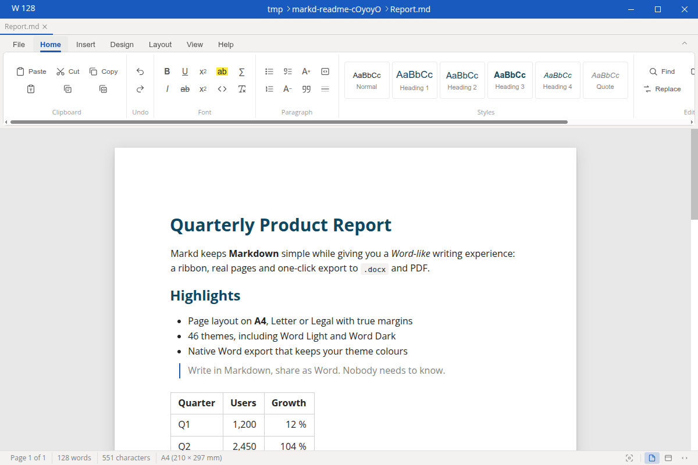
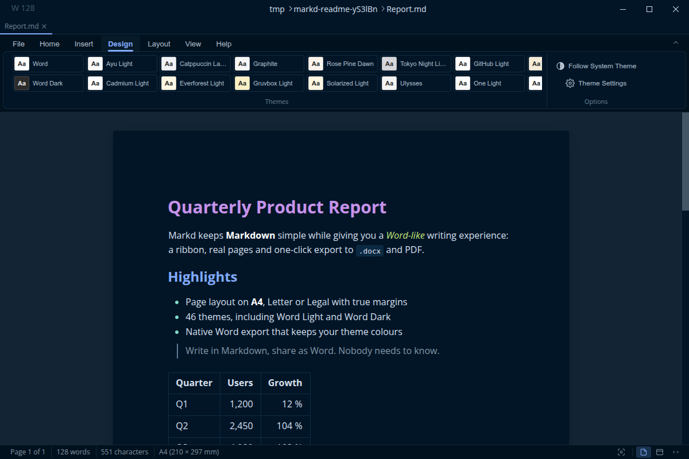
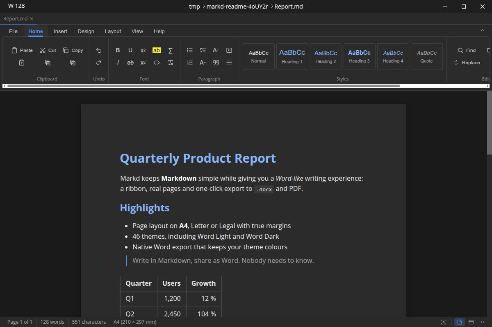
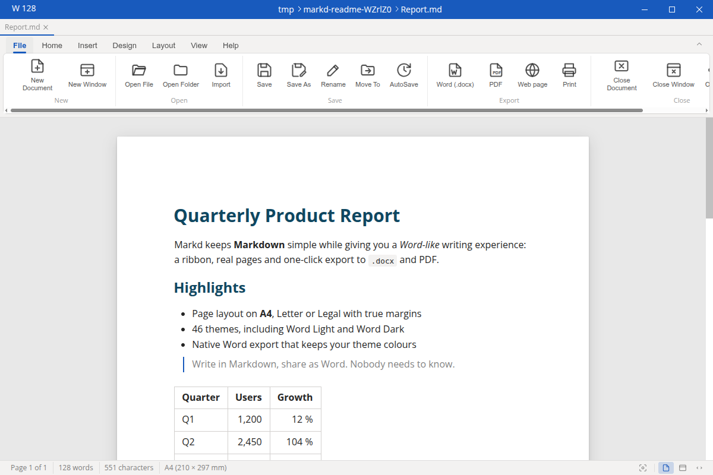

<div align="center">


# Markd

**Write in Markdown. Work like it's Word.**

A free, open-source Markdown editor with a Word-style ribbon, real A4 pages
and one-click Word / PDF export, for Linux, Windows and Android. On Android it
also takes handwritten notes and annotates PDFs.

[](https://github.com/Hafij-BGE/markd/releases/latest)
[](https://github.com/Hafij-BGE/markd/releases)
[](https://github.com/Hafij-BGE/markd/actions/workflows/release.yml)
[](LICENSE)


[Download](#download) · [Features](#features) · [Android](#android) · [Build from source](#build-from-source) · [Credits](#credits)



</div>

## Why Markd

- **No account, no subscription, no paywall.** Every feature is free, forever, under the MIT License.
- **Familiar from the first minute.** File, Home, Insert, Design, Layout, View and Help live in a ribbon you already know.
- **What you see is what you send.** The page on screen has the same size, margins, font and theme as the exported `.docx` or PDF.
- **Plain files.** Your documents stay ordinary `.md` files that any editor, Git or note app can read.

## Download

Get the latest build from the [Releases page](https://github.com/Hafij-BGE/markd/releases/latest).

| Platform | File | Install |
| --- | --- | --- |
| Debian, Ubuntu, Mint | `markd-linux-amd64-<version>.deb` (`arm64` too) | `sudo apt install ./markd-linux-amd64-<version>.deb` |
| Fedora, openSUSE | `markd-linux-x86_64-<version>.rpm` (`aarch64` too) | `sudo dnf install ./markd-linux-x86_64-<version>.rpm` |
| Any Linux | `markd-linux-x86_64-<version>.AppImage` (`arm64` too) | `chmod +x markd-*.AppImage`, then run it |
| Any Linux, portable | `markd-linux-x64-<version>.tar.gz` (`arm64` too) | Extract it and run `./markd` |
| Windows 10/11 | `markd-win-x64-<version>-setup.exe` | Run the installer |
| Windows, portable | `markd-win-x64-<version>.zip` | Extract it and run `markd.exe` |
| Android 8.0+ | `Markd-<version>-android-debug.apk` | See [Android](#android) |

Every release lists the SHA-256 of each file in `SHA256SUMS.txt`:

```bash
sha256sum -c SHA256SUMS.txt --ignore-missing
```

## Features

### A Word-style workspace

- **Ribbon** with every command in one place: clipboard, fonts, paragraph styles, tables, images, themes, page setup, export, view modes and help. Double-click a tab to collapse it.
- **Style gallery** for Normal, Heading 1–4 and Quote, plus one-click bold, italic, underline, strikethrough, highlight, super/subscript, inline code and math.
- **Status bar** with page *x* of *y*, word and character counts, and Print Layout / Web Layout / Source buttons.

### Real pages

- Write on an **A4, US Letter or US Legal** sheet with Narrow, Moderate, Normal or Wide margins.
- Lines wrap exactly as they will in the exported Word or PDF file.
- Switch to **Web Layout** for a free-width column, or **Source** for the raw Markdown.

### 46 themes



Pick a theme from the **Design** tab: **Word** and **Word Dark** (the defaults), GitHub Light/Dark, One Light, Sepia, Vitesse Light/Dark, Quiet Light, Night Owl, Cobalt2, Zenburn, Moonlight, and all 33 MarkText themes such as Dracula, Nord, Catppuccin, Gruvbox, Tokyo Night and Rosé Pine. *Follow System Theme* switches between Word and Word Dark with your desktop.

### One-click export

- **Word (.docx)**: native export, no pandoc needed. It keeps your theme colours, fonts, page size, margins, page colour and page numbers.
- **PDF**: tagged PDF with a clickable outline, painted edge to edge in your theme.
- **HTML**: a single self-contained page in your theme.
- **Print**: straight to the system print dialog.

Export uses the theme and page layout you are editing with, so there is no options dialog to fill in.

### Everything MarkText does well

- CommonMark and GitHub Flavored Markdown with real-time preview in place.
- KaTeX math, Mermaid, PlantUML, Vega-Lite, flowchart and sequence diagrams.
- Tables, task lists, footnotes, front matter and syntax-highlighted code blocks.
- Focus mode, typewriter mode, a file tree, tabs, and search across a whole folder.
- Paste images from the clipboard and save them next to your document.

<table>
  <tr>
    <td></td>
    <td></td>
  </tr>
  <tr>
    <td align="center"><sub>Word Dark theme</sub></td>
    <td align="center"><sub>File tab: open, save and one-click export</sub></td>
  </tr>
</table>

## Android

Markd runs on Android phones and tablets (Android 8.0 or newer). The Markdown
editor has the same Word-style ribbon, Word Light/Dark themes, A4/Letter/Legal
page view, and HTML, PDF and Word export. Around it, the Android app adds:

**One home for all your files.** Markd opens to a grid of a folder you pick
once, such as `Documents/Markd`, with previews of your Markdown files, drawings
and PDFs, a *Recent* row, folders, search, sort and pins. The **+** button
starts a Markdown file, a drawing or a PDF annotation, or imports a file. Each
opens in its own editor, and *Back* brings you home. Everything stays an
ordinary file in that folder, so file managers, your computer and sync apps can
see it, and it survives uninstalling the app.

**Drawing and PDF annotation**, modelled on [Xournal++](https://xournalpp.github.io/):

- Pen with pressure, five widths and dashed/dotted lines, a highlighter, an
  eraser, text, images, shapes with a shape recogniser, and lasso or rectangle
  selection to move, resize, copy or recolour.
- **Opacity** for the pen, the highlighter and fills: tap the `%` button in the
  toolbar.
- Pages, layers, undo/redo, pinch zoom, and *draw with stylus only* so fingers
  scroll.
- Drawings are `.ink` files in the Xournal++ file format: rename one to `.xopp`
  to open it in desktop Xournal++, and desktop `.xopp` files open in Markd.
- **Your PDFs are never copied or changed.** An annotation is a small `.ink`
  file that remembers where the PDF is, so it is found again even after
  reinstalling the app (allow *All files access* when asked) unless the PDF
  was moved. A PDF can have several annotations; tapping it lets you pick
  one, delete one or start another.
- *Export PDF to folder* saves a copy with your ink drawn in. The original
  pages stay sharp and their text stays selectable.

**Built for the stylus in the editor:**

- **Pen to text** (Android 14+): write on the page and your handwriting becomes text.
- **Sketch** opens the drawing canvas and inserts the result as an image you can
  reopen with *Edit in Inkwell*. *Quick sketch* is the simple pad.
- **Palm rejection** while the pen is in use, plus pen eraser and side-button support.

**Install:**

1. Download `Markd-<version>-android-debug.apk` from [Releases](https://github.com/Hafij-BGE/markd/releases/latest) on the device.
2. Open it and allow *Install unknown apps* for your browser or file manager when Android asks.
3. Open Markd, tap **Choose folder** and pick or create a folder for your files (for example `Documents/Markd`).

From 0.24.4 every release APK is signed with the same key, so a new version
installs over the old one and keeps your settings. APKs from 0.24.3 and earlier
releases were each signed with a different key: if Android says "package
conflicts with an existing package", uninstall Markd once and install the new
APK. Your files in the chosen folder are not affected; pick the same folder
again on first launch.

## Build from source

You need Node.js 22 or newer and pnpm 10 (via Corepack).

```bash
git clone https://github.com/Hafij-BGE/markd.git
cd markd
corepack enable
pnpm install
pnpm dev            # run the desktop app with hot reload
```

To build installers:

```bash
pnpm build:linux    # AppImage, deb, rpm, tar.gz in dist/
pnpm build:win      # setup.exe and zip in dist/ (run on Windows)
```

On Debian/Ubuntu the native modules need these headers:

```bash
sudo apt install build-essential python3 libx11-dev libxkbfile-dev libsecret-1-dev libfontconfig-dev rpm
```

The Android app has its own build guide in [packages/android/README.md](packages/android/README.md).

### Checks

```bash
pnpm lint
pnpm typecheck
pnpm test:unit
pnpm test:e2e
```

### Project layout

| Path | What it is |
| --- | --- |
| `packages/desktop` | Electron + Vue 3 desktop app (ribbon, themes, export) |
| `packages/muya` | `@muyajs/core`, the WYSIWYG Markdown engine |
| `packages/android` | Android app: a WebView shell around `@muyajs/core` |
| `packages/android/android/inkwell` | Android home screen, drawing and PDF annotation (Java, PdfBox-Android) |
| `scripts/` | Workspace scripts, including `generate-icon.py` for the app icon |

### Releasing

Bump the version in `packages/desktop/package.json`, `packages/android/package.json`
and `packages/android/android/app/build.gradle`, then push a tag such as `v0.24.3`. The [release workflow](.github/workflows/release.yml) builds Linux (x64, arm64), Windows (x64) and Android, then publishes a GitHub release with checksums.

## Credits

Markd is a fork of [MarkText](https://github.com/marktext/marktext) by Luo Ran (Jocs) and the MarkText contributors. The editing engine and most of the app come from their work, so please consider supporting the [MarkText project](https://github.com/marktext/marktext).

The Android drawing and PDF-annotation tools are modelled on
[Xournal++](https://github.com/xournalpp/xournalpp) and use its file format;
no Xournal++ code is included. Their icons are [Lucide](https://lucide.dev)
icons (ISC License), as shipped with Xournal++, and PDFs are read and written
with [PdfBox-Android](https://github.com/TomRoush/PdfBox-Android) (Apache 2.0).

Markd keeps MarkText's [MIT License](LICENSE). Third-party licenses are listed in [packages/desktop/build/THIRD-PARTY-LICENSES.txt](packages/desktop/build/THIRD-PARTY-LICENSES.txt).
